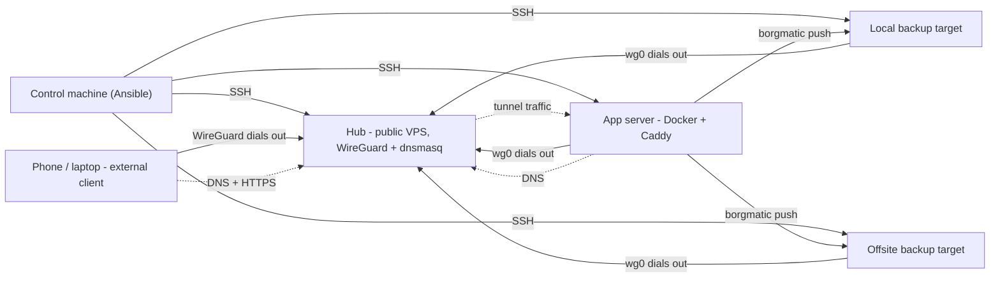

# home-server-provisioner

Ansible-based provisioning toolkit for Debian self-hosted servers.

Prepares fresh Debian hosts with system hardening, a dedicated management user, and a baseline configuration - ready for Docker workloads, reverse proxying, VPN connectivity, and automated backups.

## Architecture



The diagram shows the stack-based ingress: Caddy runs on the app server and
the hub only forwards tunnel traffic. With the native role, Caddy runs on
the hub instead. See [docs/caddy.md](docs/caddy.md).

The fleet is hub-and-spoke: exactly one host acts as the hub (the
`vpn_server` group, usually a VPS with a public IP), and it is the only
machine that needs an inbound port. Every managed peer and every external
client dials out to it, which is why app servers and backup targets can
sit behind NAT or on a mobile network. All servers share one
`10.10.0.0/24` WireGuard network, with the hub also running dnsmasq so
names resolve to tunnel addresses. Backups are pushed - never pulled -
from app servers to their `backup_targets` over that same tunnel, both to
a local target and to an off-site one. See
[docs/networking.md](docs/networking.md) for the full topology and
[docs/backups.md](docs/backups.md) for the backup flow.

## Supported platform

- Debian 13 (trixie)

## Prerequisites

- A control machine (Linux or macOS) with SSH access to your servers
- An SSH key pair (`ssh-keygen` if you don't have one)
- [Homebrew](https://brew.sh) or [pipx](https://pipx.pypa.io) for installing Ansible
- For local testing: [Incus](https://linuxcontainers.org/incus/) on a Linux workstation

## Quick start

### 1. Install dependencies

```bash
make setup
```

This installs Ansible, ansible-lint, and required collections. It auto-detects Homebrew or pipx, or you can specify:

```bash
./scripts/setup.sh brew    # or: ./scripts/setup.sh pipx
```

### 2. Set up your configuration

```bash
make init-config            # default: creates configs/prod/
# make init-config ENV=lab  # or any other name; one tree per environment
```

This copies `configs/example/` to `configs/<ENV>/` and initialises a fresh git repo inside it - you can push that repo to a private remote to back up your config independently of this provisioner repo.

Edit `configs/prod/inventory/hosts.yml` and add your hosts. Each host needs:

- `ansible_host` - the IP address or hostname
- `bootstrap_user` - the SSH user on a fresh install (typically the regular user you created during the Debian installer, or `root`)

```yaml
app_servers:
  hosts:
    my-server:
      ansible_host: 10.0.0.1
      bootstrap_user: jan
```

Edit `configs/prod/inventory/group_vars/all/main.yml` to configure roles. All options have sensible defaults - uncomment and adjust what you need.

Two files ship as templates and are copied verbatim by `make init-config`; rename/copy them manually before use (only `hosts.yml.example` is renamed automatically):

- `inventory/host_vars/home-app.yml.example` → `inventory/host_vars/<hostname>.yml` for per-host settings.
- `inventory/group_vars/all/vault.yml.example` → `inventory/group_vars/all/vault.yml`, then run `make vault-encrypt` (or let `wg-ensure-keys.py` create and encrypt the real vault on the first provision). It is a plain-text template with no real secrets.

Edit `.env` if your SSH key isn't `~/.ssh/id_ed25519` (the file lives in this repo root, not in `configs/`, because it tunes the provisioner itself).

A host can belong to multiple groups:

| Group | Purpose |
|---|---|
| `app_servers` | Docker + Compose workloads |
| `backup_targets` | Backup storage, borgmatic destinations |
| `vpn_server` | WireGuard hub and central DNS (dnsmasq). Exactly **one** host - the topology is hub-and-spoke. Caddy can run natively here or as a Compose stack on an app server; see [docs/caddy.md](docs/caddy.md). |

A host can belong to several groups, but `dnsmasq` (`vpn_server`) and `dns_client` (`app_servers`) both manage `/etc/resolv.conf`. Do not combine those two roles on one host without choosing one resolver owner. See [docs/networking.md](docs/networking.md#dns-who-owns-etcresolvconf).

### 3. Bootstrap (first run only)

```bash
make bootstrap              # ENV=prod by default
```

This connects as each host's `bootstrap_user`, creates a dedicated `ansible` user with sudo and SSH key access. Run this once per host.

### 4. Provision

```bash
make provision              # ENV=prod by default
```

Runs the full provisioning playbook as the `ansible` user. Safe to re-run - all tasks are idempotent.

### 5. Deploy only Compose stacks

```bash
make stacks ENV=prod LIMIT=app1
```

Runs only the `compose_deploy` role. Use this to apply stack, `.env.j2` or
`Caddyfile.j2` changes without running the full system provisioning. Docker
and the external networks must already exist on the host.

### Multiple environments

Every command takes an `ENV=<name>` override. Each environment is a self-contained tree under `configs/<name>/`:

```bash
make init-config ENV=prod2          # configs/prod2/, separate git repo
make vault-init  ENV=prod2
make provision   ENV=prod2
```

## Secrets management

Sensitive material (WireGuard client private keys and PSKs) lives in
`configs/<ENV>/inventory/group_vars/all/vault.yml`, encrypted with
[ansible-vault](https://docs.ansible.com/ansible/latest/vault_guide/index.html).
You never edit this file by hand - it is auto-managed.

`make vault-rekey ENV=<name>` prompts for a new password, re-encrypts the
vault, and replaces `.vault_pass` with the new password (mode 600). Commit
the changed vault file afterwards; `.vault_pass` remains gitignored.

**Setup (one-time, per environment):**

```bash
make init-config ENV=prod   # creates configs/prod/ (its own git repo)
make vault-init  ENV=prod   # prompts for password → configs/prod/.vault_pass (mode 600)
```

The variables the roles consume are documented in the plain-text template
`configs/prod/inventory/group_vars/all/vault.yml.example`. Copy it to
`vault.yml` and encrypt it with `make vault-encrypt ENV=prod` if you want to
set values (such as `vault_borgmatic_passphrase`) explicitly; otherwise the
first `make provision` creates and encrypts the file when it generates
WireGuard client keys.

**Daily use - declarative client management.**

Define every WireGuard client (phones, laptops) in
`configs/prod/inventory/group_vars/all/main.yml`:

```yaml
wireguard_clients:
  - { name: phone, vpn_ip: 10.10.0.20 }
  - { name: laptop,  vpn_ip: 10.10.0.21, allowed_ips: "0.0.0.0/0" }
```

Run `make provision`. The first stage (`wireguard-keys`) automatically:

1. Generates `privkey`, `pubkey`, `psk` for every new client.
2. Prunes vault entries whose name disappeared from `main.yml`.
3. Re-encrypts `vault.yml` and **auto-commits** the change into the
   `configs/prod/` repo (e.g. `wireguard keys: add phone`).
4. Hands off to the playbook, which renders `[Peer]` sections on the hub.

Rendering the client's `.conf` + QR PNG for distribution is a **separate,
on-demand step** - `make provision` never writes private-key material to
your disk. When you actually need to onboard a phone or laptop:

```bash
make wireguard-render      # writes build/<env>/wireguard/<name>.{conf,png} (mode 0600)
# scan the QR, or scp the .conf to the target device
rm -rf build/              # delete once you're done
```

The directory is gitignored, but the files contain plaintext private keys -
treat them as one-shot, scan-and-delete artifacts.

**Safety: prune is skipped if `configs/prod/` has uncommitted changes** other
than `vault.yml` itself (catches the "typo in name" scenario where you
are mid-edit). Commit your work and re-run to apply the prune.

**Recovery:** every vault change is committed, so accidentally pruning a
key is recoverable with `git -C configs/prod log -- inventory/group_vars/all/vault.yml`
+ `git -C configs/prod show <sha>:inventory/group_vars/all/vault.yml`.

**Escape hatches** (for debugging - normal use never needs these):

| Command | Purpose |
|---|---|
| `make vault-edit` | Decrypt → `$EDITOR` → re-encrypt |
| `make vault-view` | Read-only peek |
| `make vault-rekey` | Rotate the vault password |

**Test environment.** `make test-env-create` seeds `configs/test/` with a
literal `.vault_pass` containing `test-password`, so `make test-*` exercises
the exact same vault code paths as prod with no manual setup.

## What it does

Each role is self-contained. The full list:

### Identity and access

| Role | Description |
|---|---|
| `service_user` | Creates dedicated `ansible` service account with passwordless sudo and SSH key |
| `admin_user` | Interactive SSH user with configurable shell and packages |
| `admin_dotfiles` | Overlay-syncs `configs/<ENV>/dotfiles/_common/home/` (baseline) and `configs/<ENV>/dotfiles/<hostname>/home/` (per-host override) into the admin user's home directory; manifest-tracked, only manages files explicitly shipped |
| `ssh_hardening` | Disables root login and password authentication |

### System baseline

| Role | Description |
|---|---|
| `base` | Updates apt cache, upgrades packages, installs base packages, and seeds a resolver when the host has none |
| `hostname` | Sets the host's `/etc/hostname` from the inventory name |
| `timezone_locale` | Sets timezone and generates locales |
| `time_sync` | Verifies / configures `systemd-timesyncd` |
| `laptop_power` | Lid-switch policy and battery charge limit for laptops used as servers |
| `journal` | Enables persistent journald, optional size/retention limits |
| `auto_updates` | `unattended-upgrades` for security updates, optional auto-reboot |

### Security

| Role | Description |
|---|---|
| `firewall` | UFW with default-deny incoming, allowlist driven by `firewall_allow_rules` (SSH always open as lockout protection) |
| `fail2ban` | SSH brute-force protection with configurable ban/find times |

### Networking and ingress

| Role | Description |
|---|---|
| `wireguard` | Hub-and-spoke VPN. Generates per-host keypairs, renders `[Peer]` sections on the hub, and renders `<client>.conf` + `<client>.png` QR codes on the controller when `make wireguard-render` runs. Asserts inventory sanity (unique VPN IPs, exactly one hub). |
| `dns_client` | On app servers: rewrites `/etc/resolv.conf` to point at the WireGuard hub so local hostnames resolve through dnsmasq (and disables dhcpcd's `resolv.conf` hook when present). Backup targets do not run this role. |
| `dnsmasq` | On the hub: full LAN/VPN resolver, auto-generates host records from the inventory, forwards external queries upstream |
| `caddy` | Native Caddy option on the hub: reverse proxy with automatic TLS, sourced from `configs/<ENV>/caddy/Caddyfile` (+ optional `conf.d/*.caddy` snippets). The role is skipped when that tree is absent. The stack-based variant on an app server is documented in [docs/caddy.md](docs/caddy.md). |

### Applications (`app_servers` only)

| Role | Description |
|---|---|
| `docker_runtime` | Installs Docker CE + Compose plugin from upstream apt repo |
| `compose_deploy` | Auto-discovers and deploys Docker Compose stacks from `configs/<ENV>/stacks/_common/<name>/` (every app server) and `configs/<ENV>/stacks/<hostname>/<name>/` (per-host override). Per-stack directory is synced verbatim - drop `compose.yaml` + `.env` + `Caddyfile` + `config/` next to each other. |

> [!WARNING]
> **Published container ports bypass UFW.** Docker writes its own
> iptables/nftables rules, so a Compose `ports:` entry is reachable
> regardless of your `firewall_allow_rules`. Bind to a private address
> (`10.10.0.x:8080:8080` or `127.0.0.1:9090:9090`) or reverse-proxy
> through Caddy. See
> [roles/firewall/README.md](roles/firewall/README.md#docker-bypasses-ufw).

### Data and storage

| Role | Description |
|---|---|
| `storage` | Formats empty block devices and mounts them, with by-id device selection and the `/srv/data` layout |
| `swap` | Tops up active swap to `swap_size`, using a swap file by default |
| `network_mounts` | Client-side NFS and CIFS/SMB mounts for remote shares |

### Power, monitoring, and alerts

| Role | Description |
|---|---|
| `nut` | Network UPS Tools with USB udev rules, `upsc` verification, and the `nocomm` grace period |
| `smart_monitoring` | `smartd` disk health monitoring with `hsp-notify` alerts |
| `notifications` | Installs `hsp-notify` and the ntfy delivery backend used by other roles |

### Backups

| Role | Description |
|---|---|
| `borgmatic` | Backup source: borgmatic config, SSH key, and nightly push to `backup_targets` |
| `borg_repo` | Backup target: append-only borg repository, authorized keys, and retention |

### Scheduled work and custom files

| Role | Description |
|---|---|
| `scheduled_jobs` | systemd timers and services for periodic commands |
| `custom_scripts` | Ships scripts from `configs/<ENV>/scripts/` to `/usr/local/bin/` |
| `systemd_units` | Ships custom systemd unit files from `configs/<ENV>/systemd/` |

### Controller-side

| Role | Description |
|---|---|
| `local_ssh_config` | Generates `~/.ssh/config.d/` entries on the control machine so `ssh <hostname>` works for every inventory host |

## Stacks and dotfiles layout

`compose_deploy` and `admin_dotfiles` share an overlay convention.
For stacks, `_common/` ships to every app server; for dotfiles, it ships to
every host. Anything under `<hostname>/` overrides on a per-host basis.

```
configs/<ENV>/
├── inventory/                      → hosts.yml, group_vars/, host_vars/
├── stacks/
│   ├── _common/
│   │   └── whoami/                 → deployed to every app_server
│   │       └── compose.yaml
│   └── home-app/
│       └── forgejo/                → deployed only on home-app
│           ├── compose.yaml
│           └── README.md
├── dotfiles/
│   ├── _common/home/               → baseline files, every host
│   │   └── .config/fish/config.fish
│   └── home-app/home/              → host-specific overlay
│       └── .config/git/config
├── caddy/                          → optional native Caddy role source
├── scripts/                        → custom_scripts payloads
└── systemd/                        → systemd_units payloads
```

Resolution rules:

- **Stacks**: host-level directory wins per stack name (full override of
  the whole stack directory).
- **Dotfiles**: host overlay wins per file (file-level merge - a host can
  add new files without re-shipping the whole baseline).

Escape hatch: set `compose_deploy_stacks: [...]` explicitly in host_vars
to skip auto-discovery entirely (rare, mostly for transient debugging).

Stack files are synced with their source mode preserved (the role does not
force `0640`). This keeps build contexts usable: Docker `COPY` preserves
modes, so a file that is private on the controller stays unreadable for a
non-root user inside the image. Keep build-context files `0644`/`0755` and
add a `chmod` in the `Dockerfile` if a private source mode cannot change.
The rendered `.env` is still written `0640`; never put secrets in a file a
build container must read. See
[roles/compose_deploy/README.md](roles/compose_deploy/README.md#file-modes-and-build-contexts).

## Development

### Make targets

`make help` prints the current list. The most useful targets:

| Target | Purpose |
|---|---|
| `make setup` | Install Ansible, ansible-lint, and the required collections |
| `make init-config ENV=prod` | Create `configs/prod/` from the example tree |
| `make bootstrap ENV=prod` | First run on fresh hosts |
| `make provision ENV=prod` | Full site play |
| `make stacks ENV=prod LIMIT=<host>` | Deploy only Compose stacks |
| `make ssh-config ENV=prod` | Regenerate the controller's `~/.ssh/config.d/` entry |
| `make host HOST=<name>` | Show inventory variables, with secrets redacted |
| `make plan LIMIT=<host>` | List the tasks that would run |
| `make wireguard-keys ENV=prod` | Generate and prune client keys |
| `make wireguard-render ENV=prod` | Render client `.conf` and QR code into `build/` |
| `make vault-init`, `vault-edit`, `vault-view`, `vault-encrypt`, `vault-rekey` | Vault lifecycle |
| `make vault-decrypt ENV=prod` | Decrypt the vault in place; dangerous, avoid on shared hosts |
| `make test-local` | Fast local tests: `.j2` rendering, Makefile wiring, vault rekey |
| `make notify-test HOST=<host>` | Send an `hsp-notify` smoke test |
| `make test-local` | Fast local tests, no Incus or Docker |
| `make test-borgmatic` | Test borgmatic host override, lz4, hooks and OnFailure |
| `make test-env-create`, `test-env-status`, `test-env-destroy` | Manage the Incus test VMs |
| `make test-bootstrap`, `test-provision`, `test-wireguard-render`, `test-nut`, `test-smoke`, `test-reboot` | Test suites |
| `make validate-stacks ENV=prod` | Validate stack image digests and tags |
| `make lint` | Run ansible-lint |

### Linting

The repository lints clean at `ansible-lint`'s strictest built-in profile
(`production`):

```bash
make lint
```

CI runs the same command on every push and pull request. Configuration lives in
`.ansible-lint`; the workflow is `.github/workflows/ansible-lint.yml`.

### Validating stack images

```bash
make validate-stacks ENV=prod
make validate-stacks ENV=prod REGISTRY=1   # also query the registries
```

The check scans `configs/<ENV>/stacks/**/docker-compose.yml`,
`compose.yml` and `compose.yaml` and validates every `image:` reference:

- a malformed `@sha256:` digest is always an error (the value must be 64
  hex characters);
- an unpinned tag is a warning by default, so known moving tags do not block
  provisioning;
- with `REGISTRY=1`, every pinned digest must resolve to a real registry
  manifest (uses `docker manifest inspect`, `skopeo`, or `crane`; needs
  network access). Images without a digest are skipped by this check.

Allowlist tags that intentionally follow a moving tag in
`configs/<ENV>/stacks/validate-allowlist.txt` (one pattern per line, `#`
comments) or pass `--allow-tags` directly to the script. A pattern matches
when it is a case-insensitive substring of the repository, or a glob matched
against the reference. Use `--strict-tags` to turn tag warnings into errors.

`make provision` never queries a registry; digest checking is opt-in.

### Inspecting a host before provisioning

```bash
make host HOST=app-1        # inventory variables, obvious secrets redacted
make plan LIMIT=app-1       # tasks the playbook would run
```

`make plan` does not evaluate `when:` conditions, so it lists every task in the
play, including ones that would be skipped on that host.

## Testing

The project includes tooling for local testing with [Incus](https://linuxcontainers.org/incus/) VMs (Linux only).

### One-time Incus setup (Fedora example)

```bash
sudo dnf install -y incus incus-tools
sudo usermod -aG incus-admin $USER
sudo systemctl enable --now incus.socket
sudo incus admin init --minimal
# Log out and back in (or `newgrp incus-admin`) so the group takes effect.
```

If you use `firewalld` (Fedora's default), trust the Incus bridge so VMs get IPv4 via DHCP:

```bash
sudo firewall-cmd --permanent --zone=trusted --add-interface=incusbr0
sudo firewall-cmd --reload
```

For Debian/Ubuntu/Arch hosts, follow [the official Incus install guide](https://linuxcontainers.org/incus/docs/main/installing/).

### Test loop

```bash
make test-env-create        # Launch VMs, install sshd, create initial user
make test-bootstrap         # Bootstrap the ansible service user
make test-provision         # Run full provisioning
make test-wireguard-render  # Render build/test/wireguard/test-controller.{conf,png}
make test-nut               # Apply the NUT role with dummy-ups and check reactions
make test-smoke             # End-to-end check via WG (sudo: brings the tunnel up, curls the proxied site, cleans up)
make test-reboot            # Reboot every VM and verify services persist across reboots
make test-env-status        # Show test VM status
make test-env-destroy       # Tear down VMs
```

`make test-smoke` brings the rendered `build/test/wireguard/test-controller.conf`
up on this machine, pings the hub + a managed peer, resolves
`whoami.home` through dnsmasq, fetches `https://whoami.home/` through
Caddy (TLS internal), and verifies the backend saw the request via the
tunnel. Trap-based cleanup always tears the tunnel down on exit. Read
`scripts/test-smoke.sh` if you want to know exactly what it touches
before granting sudo.

`make test-reboot` restarts every test VM and asserts that the
infrastructure services come back automatically - enabled **and** active
on boot (ssh, fail2ban, WireGuard, plus dnsmasq on the hub, Caddy on the
app server, and Docker on app servers), the firewall is still up, and every timer that
was active before the reboot is re-armed. This guards against
provision-only-correct setups that silently fail to survive a power
cycle.

VM defaults (image, CPU, memory, initial username) live in `.env` - see `.env.example`.

### Multi-environment test VMs

The test loop above is just one instance of a more general pattern: the
`scripts/incus-env.sh` script can manage Incus VMs for any environment.
The Makefile is fully multi-env (`ENV=<name>` on every target), and
artifacts that would otherwise collide are partitioned per env:

| Artifact | Partitioned by |
|---|---|
| Config tree | `configs/<env>/` |
| Vault password | `configs/<env>/.vault_pass` |
| WG client `.conf`/`.png` | `build/<env>/wireguard/` |
| Local SSH config | `~/.ssh/config.d/home-server-provisioner-<env>` |

To spin up a new long-lived Incus-backed environment (e.g. `demo`):

```bash
# 1. Declare the VMs (local-only: scripts/*.conf is gitignored except test-vms.conf)
cat > scripts/demo-vms.conf <<'EOF'
demo-hsp-vpn:vpn_server:vpn_ip=10.10.0.1,wireguard_role=hub
demo-hsp-app:app_servers:vpn_ip=10.10.0.2
EOF

# 2. Create the config tree (separate private git repo inside it)
make init-config ENV=demo
make vault-init  ENV=demo
# Edit configs/demo/inventory/group_vars/all/main.yml, stacks/, caddy/, etc.

# 3. Spin up the VMs and provision
./scripts/incus-env.sh demo create   # writes configs/demo/inventory/hosts.yml
make bootstrap ENV=demo
make provision ENV=demo
make wireguard-render ENV=demo          # → build/demo/wireguard/
```

**`hosts.yml` is auto-generated** by `incus-env.sh` because Incus assigns
random DHCP IPs to fresh VMs, so the inventory has to be rewritten on
every `create` to track them. Don't hand-edit it; put per-host overrides
in `inventory/host_vars/<vm>.yml` and group-level config in
`group_vars/all/main.yml`. If you instead want a hand-managed `hosts.yml`
(real hardware, hosted VMs, mixed inventory) - just don't use
`incus-env.sh` for that env. The two modes are mutually exclusive per
env, not per project.

VM names are **global to Incus**, so pick a unique prefix (`demo-…`)
when running multiple envs side-by-side to avoid collisions with the
`test` env's `hsp-…` names.

## Further reading

- [Networking](docs/networking.md) - hub-and-spoke topology, `vpn_ip` addressing, DNS ownership, firewall interaction
- [WireGuard clients](docs/wireguard-clients.md) - onboarding phones and laptops, key management, split vs full tunnel
- [Backups](docs/backups.md) - borgmatic/borg topology, restore, passphrase rotation, monitoring
- [Caddy reverse proxy](docs/caddy.md) - stack-based and native modes, TLS, DNS, firewall, troubleshooting
- [Deployment Guide](docs/deployment-guide.md) - multi-site setups, off-site hosts, and VPN connectivity
- [Conventions](docs/conventions.md) - role, variable, template, and make-target naming rules this repo enforces

## License

[Apache 2.0](LICENSE)
